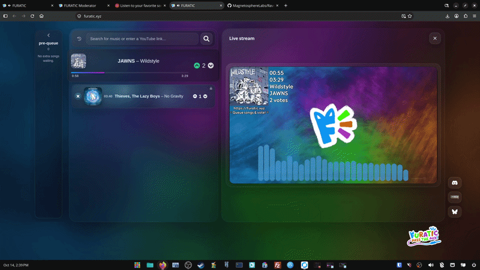
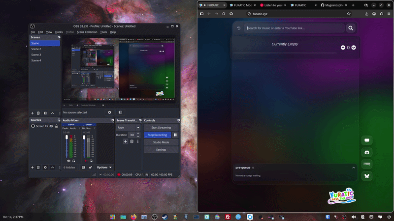
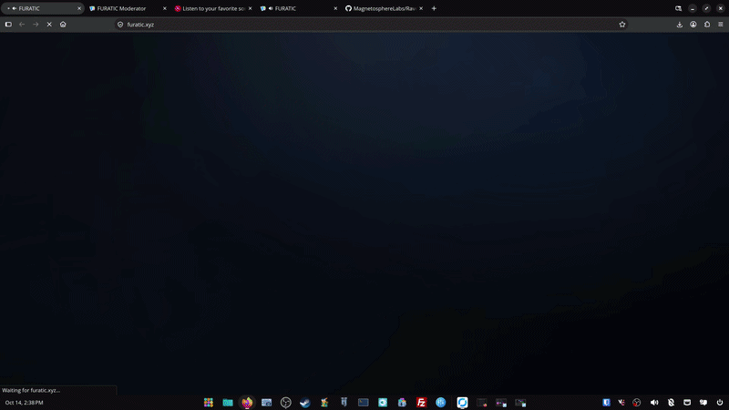
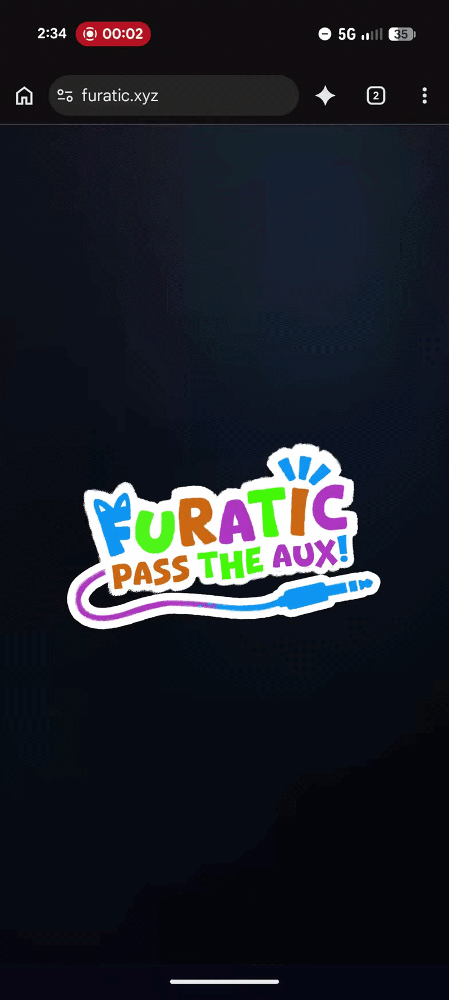
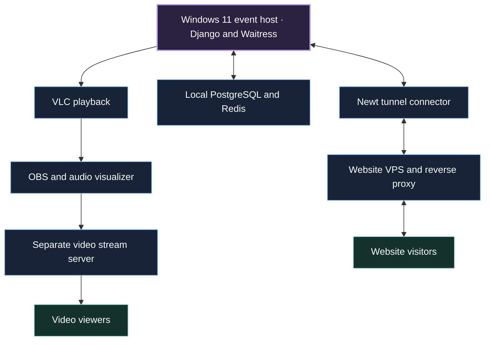

<div align="center">


# RaveFurry


<a href="LICENSE"></a>

<br><br>

[The event](#one-event-three-states) ·
[Moderation](#moderation-while-the-music-keeps-playing) ·
[UI and frontend](#an-interface-for-the-event) ·
[Architecture](#how-our-windows-setup-is-connected) ·
[Recovery](#when-something-stops-responding) ·
[Raveberry roots](#what-we-inherited-and-what-we-changed)

</div>

RaveFurry runs our [FURATIC Pass the Aux events](https://vrchat.com/home/group/grp_abb22096-1394-451f-bb13-0e4f9d63b9fb). People can request songs from their browser, vote on the main queue, and watch the event stream in our event world or on the site. Moderators keep the queue managed, review songs that need attention, and bring the event to a close.

It started with [Raveberry](https://github.com/raveberry/raveberry), and a substantial amount of that foundation is still here. We have since built a different public interface, a dedicated moderation workflow, a fairer way to handle additional requests, and a Windows runtime with persistent queue state and automatic recovery.

The current setup runs on a Windows 11 machine, a 2013 Mac Pro. The website reaches the public through a VPS and a Newt tunnel. OBS sends its video through a separate stream server. That is the deployment this README describes, and the reason behind many of the choices in this fork.

<p align="center">
  
</p>

## One event, three states

The site follows the event instead of presenting the same page all the time.

| State | What happens |
| :--- | :--- |
| **Event** | Song requests are open. The main queue plays, people vote, and extra requests wait in the pre-queue. |
| **Closing time** | New requests stop and the pre-queue is cleared. The song already playing and the remaining main queue continue. |
| **After hours** | The public page becomes an event wrap-up, with top songs and recent listening history. |

Closing time disables the paths that would otherwise allow people to keep adding music, and switches to after hours once the current song has finished and the main queue is empty.

After hours keeps the event visible after the music stops. **Top songs** ranks up to 20 distinct songs by the votes recorded on their plays during the last event. **Song history** is a separate view: up to 50 recent songs, newest first.

## Requests, votes, and a fair turn

The main queue and the pre-queue have different jobs. A person's first active request gets their place in the main queue. Additional requests go into the pre-queue, with a limit of five active songs per person, including any song currently playing. Those extra songs become eligible for promotion into the main queue when that person's existing current song has finished playing.

A pre-queue song cannot be voted into playback before it has earned a main-queue place. The main queue then uses votes to order eligible songs. The next song in line after the currently playing song gets locked in place so other songs can't cut in front of it.

Requests also pass through cooldown, replay, duration, and duplicate checks. A request must finish downloading and pass our automated requirements before it can play. Voting can move songs through the main queue so they play sooner, and a total of -2 downvotes can remove a queued song or skip the current one.

## Moderation during the event

<p align="center">
  
</p>

The moderation panel brings the current song, queue, review decisions, event controls, and recent activity into one place. A moderator can approve or deny a held song, remove a request, skip any song, or begin closing time without moving through unrelated settings pages.

The review pipeline can check available lyrics against our event rules to hold a song for a human decision. A song marked as analyzing or awaiting review cannot become playable until it passes automated or manual review.

There are separate permissions for song moderation and broader moderation controls, with account management reserved for administrators. The backend checks those permissions on the actions themselves. The dashboard also provides IP bans, whitelists, blocklist management, and a searchable activity trail for analyzing a request or moderation decision.

If the backend is restarting for any reason, the dashboard reconnects and refreshes its data **without reloading the document**, preserving the browser's audio permission and the enabled alert state for moderator notifications. An expired login is handled separately.

## An interface for the event

The public page is built around the queue, readable song cards, a responsive pre-queue, and a video player. The layout changes with the available screen space, and expanding panels and page entrances share the same visual design.

<p align="center">
  
</p>

Opening the video player starts the media stream. The page does not begin fetching the stream just because someone opened the queue. If playback fails, the player tries multiple reconnect attempts.

<details>
<summary><strong>Page entrances on desktop and mobile</strong></summary>

<br>

<table>
  <tr>
    <th>Desktop</th>
    <th>Mobile</th>
  </tr>
  <tr>
    <td valign="top"></td>
    <td valign="top"></td>
  </tr>
</table>

</details>

## How our Windows setup is connected



In our deployment, the host sits on a closed network. [Newt](https://github.com/fosrl/newt) makes the outbound tunnel connection for the web resource; the public website VPS proxies traffic through it. The Windows web server listens on loopback, and the tunnel exposes that web service rather than opening general access to the machine. PostgreSQL, Redis, and playback stay local.

OBS has its own delivery path through a different server. More people watching the video means more distribution traffic at that stream server, rather than a separate encode or direct stream from the event PC for every viewer. Website requests and video distribution therefore have different resource demands.

The Windows launcher manages the application and local service lifecycle. Waitress handles HTTP requests, and VLC plays cached local audio through the Windows playback path. The Pi-oriented Mopidy setup from upstream is not the playback path used here.

## How the frontend stays in sync

### Pages have their own boundaries

The custom pages keep their markup, styling, and page-specific JavaScript together. That makes the event page, the after-hours page, and the moderation panel separate places to work on, matching the different jobs they do.

| Frontend file | Its job |
| :--- | :--- |
| [`landing.html`](backend/templates/landing.html) | The main event shell, video player, and public notifications. It embeds the queue interface. |
| [`musiq_embed.html`](backend/templates/musiq_embed.html) | The queue markup and its page-specific presentation, working with the compiled TypeScript frontend. |
| [`moderator.html`](backend/templates/moderator.html) | The moderation dashboard, its controls, and its browser-side refresh and reconnect behavior. |
| [`landing_afterhours.html`](backend/templates/landing_afterhours.html) | The after-hours presentation, top-song list, and expanding listening history. |

Permission checks, queue changes, ranking queries, and playback decisions happen in Python on the server. The inherited [`frontend/ts`](frontend/ts) code also remains in use and has been expanded for queue updates, voting, panels, and browser state. The frontend build compiles that code into the bundle used by the queue interface.

This is a page-oriented frontend over a shared backend. We keep the custom page behavior in the page it belongs to, while retaining the TypeScript machinery that already serves the queue.

### Fast feedback, confirmed state

For a vote, it first needs the server's personal-vote state for that song occurrence. It can then show the button press and provisional count immediately, marks the operation as pending, and sends the desired choice with the occurrence ID, vote revision, and a unique mutation ID.

The backend checks the song, ownership, voting mode, cooldowns, and current state before committing the change. Its response supplies the confirmed choice and total.

A timed-out POST is handled as an uncertain result. The server may already have committed it, so the client re-reads the state instead of blindly submitting the same action again. The database also recognizes repeated mutation IDs. This is what keeps a lost response or a second tab from quietly turning one intended vote into multiple.

### The server orders the queue

The browser renders the order supplied by the backend. The backend uses the same effective ordering for its public queue and playback selection, with eligibility checks keeping songs held for manual review, dowloading, and pre-queue songs out of playback.

Positive vote totals determine priority in the main queue. Scores below one share an ordering floor of one. That floor affects sorting, not the displayed score or the separate downvote-removal threshold. With voting disabled, the queue index supplies the ordinary order.

Pre-queue ordering is separate from vote ranking: it is a stable rotation across requesters, with older extras promoted when they become eligible. Queue changes run under backend coordination. Even a completed download must recheck that its request still exists, so slow downloads cannot resurrect a song that was just removed.

### Animation follows real changes

Song cards are keyed by their playback occurrence. A refresh updates and moves existing nodes, creating or removing only the rows that changed. The list measures card positions before and after a confirmed update and animates the distance between them.

The handoff from the queue into the current-song card has its own shared-element transition. Pre-queue expansion measures the surface and moves its labels while crossfading the compact artwork preview into the full list.

Backend state remains the source for song approval, committed votes, and playback progress.

## State that lasts, and state that can be rebuilt

| State | Where it belongs |
| :--- | :--- |
| Current song, queued requests, votes, ownership, and listening history | PostgreSQL |
| Fast coordination, notifications, and temporary presentation state | Redis |
| Runtime settings and an additional queue/playback recovery snapshot | Local persisted files |
| Open panels, pending visual feedback, and enabled moderation notifications | The current browser page |

Redis helps coordinate live work, but it is not the sole copy of the queue or votes. A stable browser identity lets the server associate requests with the same browser across application restarts. Moderator login sessions are also retained across normal restarts; startup does not needlessly reset unchanged account passwords or invalidate sessions.

Replaying the same song later creates a new occurrence. A database uniqueness constraint keeps one vote record per voter and occurrence, with revisions protecting changes to that record. The occurrence follows the song from the queue into current playback, so the handoff does not create a fresh opportunity to vote again.

Queue mutations and playback handoffs use database transactions and coordinated locking. The critical state changes are serialized, and queue rows are locked in a consistent order. Recovery snapshots are written after releasing the queue's database lock, with a separate lock to prevent an older snapshot from overwriting a newer one.

The snapshot is an extra recovery path for the current song, queue, and voting state. It is restored when the live queue and current-song state are empty, rather than replacing a healthy queue on every start. Writes use a temporary file, flush to disk, and atomic replacement.

Listening history only includes songs whose playback actually started. Final vote totals are copied into history before the live occurrence is removed. That gives after-hours results their own durable record.

## Access controls

Django authentication, server-side role checks, and CSRF checks on the browser's state-changing actions protect the moderation workflow. Public request and vote endpoints enforce their own queue rules on the server rather than trusting just the frontend. Browser identity cookies use random tokens, with their hashes stored server-side.

IP screening combines normalized client addresses, local blocklists, explicit bans and whitelists, and detection for VPN, proxy, or datacenter traffic. Screening results are cached, with lookup budgets and deferred retries, so an ordinary page refresh does not become a fresh IP lookup. Moderators can inspect and adjust those decisions from the dashboard.

The local OBS visualizer checks local connection addresses, Host, and Origin values, and limits its local WebSocket clients. Public visitors receive the website's shared visualizer feed on a separate path, they do not get direct access to that local service.

## When something stops responding

Recovery is built at several levels because a failed download, an unavailable database, and a disconnected browser need different responses.

| Situation | What the software does |
| :--- | :--- |
| **Moderator page loses the backend** | Shows a reconnecting notice, reconnects, and refreshes server data in place. The existing page and alert notifications audio resume once the connection is restored. |
| **Application process exits or repeatedly fails health checks** | The Windows supervisor restarts the managed process. Health checks defer recovery while the audio player reports active media is still playing, to avoid an unnecessary interruption. |
| **Local PostgreSQL becomes unavailable** | The supervisor attempts to bring it back and waits for database readiness before starting the application again. |
| **Playback is restored after a restart** | Persisted state rebuilds the current song and queue. |
| **Visualizer companion stops responding** | Its supervisor checks health, restarts its own child process, and backs off between repeated failures. Ordinary silence is treated differently from a stalled audio capture. |
| **A Windows file is briefly locked** | File updates use bounded retries and atomic replacement where appropriate, including the files read by OBS. |

The application also supports scheduled maintenance restarts between songs, the current default interval is 20 completed tracks. The restart request is coordinated with playback rather than triggered in the middle of a song.

The web application and VLC playback share a managed application process. If that process really has to be replaced, playback can pause while it recovers. The purpose of the persisted state and handoff logic is to get the event resumed without throwing away its queue, song ownership, or votes.

## Processing efficiency

Our current events have seen roughly 30 simultaneous website users. Around 80 is the scale we are designing toward, with enough capacity on the host machine and the two VPS delivery paths for network traffic.

There is one event player and one audio-analysis pipeline. Each browser renders its own visual background from shared data. OBS renders its broadcast view separately.

The main queue refreshes on a two-second HTTP polling cycle, pauses that polling in hidden tabs, and prevents overlapping state requests. This replaces upstream's queue-state WebSocket updates.

The Windows HTTP server has 160 request threads, while database work from HTTP requests is gated to 80 concurrent request slots to leave room for playback and recovery. Those are concurrency limits, not a visitor limit or a benchmark of how many visitors this can handle. Request and background-task cleanup close database connections, and the normal Windows background executor reuses a worker pool instead of starting a new thread for every submitted job.

The visualizer also bounds its own work. Audio capture drops old blocks if processing falls behind. Browser rendering reuses buffers and skips a frame when the previous GPU work is still outstanding rather than building a backlog. The public background uses a capped rendering resolution, while OBS has its own more detailed design. More visitors still mean more traffic, but the audio processing remains shared.

## What we inherited, and what we changed

Raveberry gave this project much more than a starting point. The Django application, PostgreSQL support, Redis integration, provider structure, TypeScript frontend, request/vote model, and a large amount of supporting code came from upstream.

| Raveberry foundation | Where RaveFurry has taken it |
| :--- | :--- |
| A shared, vote-ordered music server | An event workflow with a main queue, fair pre-queue rotation, explicit closing time, and after-hours results. |
| General public and administrative interfaces | Custom event, after-hours, and moderation pages, with review decisions and live operational controls. |
| Django, PostgreSQL, and Redis | Persistent vote occurrences and ownership, coordinated queue changes, additional recovery snapshots, and a supervised Windows runtime. |
| A TypeScript queue frontend and WebSocket state updates | Expanded queue and vote handling, page-specific HTML/CSS/JavaScript, and HTTP polling for regular queue state. |
| Raspberry Pi/Linux deployment and Mopidy integrations | The current Windows/Waitress/VLC path, OBS exports, and a separate supervised audio visualizer. |

There are still files for integrations and deployment paths we do not use at our events. Spotify, SoundCloud, other providers, and several Pi-oriented features remain part of the inherited tree, but the current event flow is focused on YouTube requests, downloaded local audio, and VLC playback.

The `raveberry` package names and many original directories remain, too. This is an extensively modified fork with its own event behavior and interface, built on an upstream codebase we continue to credit.

<details>
<summary><strong>Where the main systems live</strong></summary>

| Area | Source |
| :--- | :--- |
| Windows launcher and supervision | [`bin/raveberry`](bin/raveberry) |
| Event transitions | [`backend/core/site_mode.py`](backend/core/site_mode.py) |
| Queue and playback | [`backend/core/musiq`](backend/core/musiq) |
| Vote persistence | [`backend/core/voting.py`](backend/core/voting.py), [`backend/core/models.py`](backend/core/models.py) |
| Browser vote confirmation | [`buttons-voting.ts`](frontend/ts/musiq/buttons-voting.ts), [`vote-state.ts`](frontend/ts/musiq/vote-state.ts) |
| Queue reconciliation and drawer animation | [`update.ts`](frontend/ts/musiq/update.ts), [`panels.ts`](frontend/ts/musiq/panels.ts) |
| Queue coordination and snapshots | [`queue_lock.py`](backend/core/queue_lock.py), [`playback_state_backup.py`](backend/core/playback_state_backup.py) |
| Moderation and activity | [`moderation.py`](backend/core/moderation.py), [`audit_log.py`](backend/core/audit_log.py) |
| Request screening | [`middleware.py`](backend/core/middleware.py), [`ip_screening.py`](backend/core/ip_screening.py) |
| Playback history | [`played_history.py`](backend/core/played_history.py) |
| OBS and visualizer | [`obs_export.py`](backend/core/obs_export.py), [`backend/visualizer`](backend/visualizer) |
| Custom pages and queue frontend | [`backend/templates`](backend/templates), [`frontend/ts`](frontend/ts) |

</details>

## Credits and original documentation

RaveFurry is developed by [Furatic](https://github.com/Furatic/RaveFurry) for our Pass the Aux events. Thank you to **the Raveberry contributors** for the software this fork grew from. The original authorship record remains in [`AUTHORS`](AUTHORS), and the repository retains its [GNU LGPL v3 license](LICENSE).

The original Raveberry README is preserved below. Its installation instructions, integrations, and screenshots describe upstream Raveberry and are kept here as part of the project's history. Current upstream development lives at [raveberry/raveberry](https://github.com/raveberry/raveberry).

<details>
<summary><strong>Original Raveberry README</strong></summary>


[](https://github.com/raveberry/raveberry/actions/workflows/publish.yml)
[](https://pypi.org/project/raveberry/)
[](https://www.reddit.com/r/raveberry/)
[](https://discord.gg/dy7Jxvjj9H)

Raveberry is a multi user music server that allows democratic selection of songs.

It provides an intuitive interface for requesting songs and changing their order according to the rating that users have made. It supports YouTube, Spotify and local files as sources for music.

A live demo is available at https://demo.raveberry.party/.


## Installation

### Try it out!

You can test a slim version of Raveberry like this:
```
sudo apt-get install -y python3-pip mopidy redis-server ffmpeg gstreamer1.0-plugins-bad
pip3 install raveberry[run]
raveberry run
```
You might need to write `~/.local/bin/raveberry run` instead. Now you can visit `http://localhost:8080/` and play a song of your choice.

This method uses a development server, with limited performance and a restricted feature set.

### Installation

In order to gain access to all features of Raveberry, install it:
```
pip3 install raveberry[install]
raveberry install
```

If you get `raveberry: command not found` you need to run `export PATH="$HOME/.local/bin:$PATH"`.
Raveberry was developed for the Raspberry Pi. If you need help setting yours up up, visit [this guide](https://projects.raspberrypi.org/en/projects/raspberry-pi-setting-up).

The installer will ask you to confirm the config file it uses. The default install supports YouTube and local files. To customize (e.g. to use Spotify), cancel the installation, edit the config at the provided path and rerun `raveberry install`.

Although everything *should* work fine, I recommend taking a backup of your system. On a Raspberry Pi this can be done by creating a copy of its SD card.

The installation will take at most 30 minutes, most of which is spent on installing/updating packages. You might need to reboot afterwards for all changes to take effect.

### Docker

Alternatively, you can use [docker-compose](https://docs.docker.com/compose/install/):
```
wget https://raw.githubusercontent.com/raveberry/raveberry/master/docker/docker-compose.yml
wget https://raw.githubusercontent.com/raveberry/raveberry/master/docker/.env
docker-compose up -d
```

For more information, consult [`docs/docker.md`](docs/docker.md).

### Remote Installation

You can also install Raveberry on a remote machine you have ssh access to:
```
pip3 install raveberry[install]
cd "$(pip3 show raveberry | grep Location: | sed 's/.*: //')/raveberry"
ansible-playbook --user <user> --key-file <private_key> -i <ip>, -e "config_file=/path/to/raveberry.yaml" setup/system_install.yaml
```
If omitted, `config_file` defaults to `backend/config/raveberry.yaml`. `--user` and `--key-file` can be omitted if the target host is configured in your ssh config.

Passwordless sudo is default on a Raspberry Pi. For most other systems, sudo requires a password, then you have to add `--ask-become-pass`.

## First Steps

After the installation has finished `http://raveberry.local/` is up and ready to play music (go ahead and try now!). If this does not take you to the musiq landing page, use the IP of the device (`hostname -I` to find out).

You can visit `http://raveberry.local/login/` and log in as the `admin` user with your provided admin password. If you take a look at `http://raveberry.local/settings` (which is also linked from the dropdown) you can see various configuration possibilities. For more information about these settings and privileges in general refer to [`docs/privileges.md`](docs/privileges.md).

An introduction to basic functionality can be found in [`docs/functionality.md`](docs/functionality.md). Or just visit the website and find out for yourself ; )

## Updating

### Webinterface

At the bottom of the `/settings` page, click "Upgrade Raveberry".
A Log will be written to `/var/www`. 

### Manual

Update the PyPi package and rerun the installation.
```
pip3 install -U raveberry[install]
raveberry install
```
Your database will be preserved, unless you specify a database backup in your config file.

### Docker
Update all of your containers in the docker-compose file:
```
docker-compose pull
```

## Features

* **Live Updates**:
Web page content is updated instantly across all clients using websockets.

* **Remote Streaming**:
With `icecast`, it is possible to remotely listen to Raveberry. See [`docs/streaming.md`](docs/streaming.md).

* **Bluetooth Support**:
Use your bluetooth speakers with Raveberry, removing the need for an audio cable.

* **HiFiBerry Support**:
Attach your [HiFiBerry](https://www.hifiberry.com/) board for a high quality audio experience.

* **Hotspot**:
Provides a WiFi network for access in areas without proper infrastructure. Can double as a repeater.

* **Remote URL**:
Specify a domain to make your Raveberry accessible from the world wide web.

* **Local Files Support**:
Play all the files you already have in your local filesystem. Various filetypes supported.

* **YouTube Support**:
With `yt-dlp` as a media provider, all of YouTube is available to play.

* **Spotify Support**:
Raveberry's music player `mopidy` can play songs from Spotify, if you to log in with your account. Spotify Premium is required.

* **Soundcloud Support**:
Songs from Soundcloud are also available for you to play. ([currently broken](https://github.com/raveberry/raveberry/issues/117))

* **Privilege Levels**:
Grant people additional permissions like playback control.

* **Graphical Admin Interface**:
Raveberry features a convenient way of modifying the behavior of the server, like hotspot configuration or download limitation.

* **Complementary App**:
[Shareberry](https://github.com/raveberry/shareberry/) lets you share songs directly from your phone to Raveberry.

* **Discord Integration**:
Control your Raveberry instance from the discord chat with the [Raveberry bot](https://github.com/raveberry/shareberry/)

* **Audio normalization**:
Raveberry uses replaygain to analyze the volume of songs and prevent sharp volume transitions.

* **Screen visualization**:
With the tool `cava`, the current music is split into its frequencies and visualized on a connected screen (See screenshot below). Code in [separate Repository](https://github.com/raveberry/visualization).

* **Audio visualization**:
Using the same tool, Raveberry can also make connected LEDs flash to the rhythm of the music.


## Optional Hardware Additions

Some of Raveberry's features rely on additional hardware. If you want to use all of them, consider upgrading your Raspberry Pi with one of these one of items:

* **WiFi Dongle**:
To provide a WiFi network for users to connect, you have to set up a second network interface. If disabled, your users have to be in the same network as Raveberry, or you have to configure an external URL.

* **LEDs**:
For audio visualization, Raveberry uses the `i2c` and `spi` protocols to control connected LEDs. They will automatically be used if they are detected at server startup. For more information see [`docs/leds.md`](docs/leds.md).

* **USB Sound Card**:
The quality of the internal Raspberry Pi sound card varies from model to model. For a better music experience I recommend using a small USB sound card.

* **USB Stick**:
If you don't want to use the Raspberry Pi's internal filesystem, you can insert an external medium like a USB stick. Its label can be specified in the config file and is then used to cache the songs.

## Tested Hardware

Raveberry is known to work on the following Hardware:
* Raspberry Pi 4
* Raspberry Pi 3B+
* Raspberry Pi Zero W

If you have something to add to the list, please let me know!

Although it is possible to install and run Raveberry on the original Raspberry Pi (after a very long installation), the hardware is just to weak for audio decoding and can not provide a pleasant experience at all.

## Uninstall

During installation a backup folder is created. It contains all files that were overwritten outside of the `raveberry/` folder. To undo installation, move these files back to their respective locations using the following command. Take care of changes you made in the meantime!
```
sudo cp -r backup_{timestamp}/* / 
```
To remove files created during the setup run
```
sudo scripts/uninstall.sh
```

## FAQ

### The current song is displayed in red and there is no sound
Red text means that Raveberry can't communicate with the player anymore. Either the player crashed or the interfacing library can't reconnect.

To fix this, first restart the player (`/settings` in "Sound Output") and wait a few seconds. If it still does not work, restart the server (`/settings` at the bottom).

### How do I use Spotify?
To enable Spotify support, install Raveberry with `spotify: true` in `raveberry.yaml`. Read how to enter your credentials [here](docs/spotify.md).

### I can't log in, it always says "Please reload"
You ran into CSRF protection. This happens when you host Raveberry behind a proxy and the protocols don't match up, e.g. `http://demo.raveberry.party` vs `https://demo.raveberry.party`.

Avoid this by providing your url either in the `raveberry.yaml` (install) or in the `.env` file (docker).

### Where are my YouTube files?

If you specified a path in your config file before installing, you will find them there. If no path was given, it will default to `~/Music/raveberry`. If you run it as `pi` using `raveberry run`, this will be `/home/pi/Music/raveberry`. If Raveberry was installed, the process is running as `www-data` and you will find the directory at `/var/www/Music/raveberry`.

### Streaming doesn't work (there is only silence)

This is a known issue on Ubuntu 20.04 and Debian Bullseye.
To fix it, downgrade `libshout3`:
```
cd /tmp
# for x86_64
wget http://mirrors.kernel.org/ubuntu/pool/main/libs/libshout/libshout3_2.4.1-2build1_amd64.deb -O libshout.deb
# for armhf (Raspberry Pi)
wget http://raspbian.raspberrypi.org/raspbian/pool/main/libs/libshout/libshout3_2.4.1-2_armhf.deb -O libshout.deb
sudo dpkg -i libshout.deb
sudo apt-mark hold libshout3
```

### I want to use the visualization without doing an install.

Install the required packages
```
sudo apt-get install cava
pip3 install raveberry[screenvis]
```
If `cava` is not available on apt, you need to [build it from source](https://github.com/karlstav/cava#from-source).

Then comment out the following line in the used cava config (add the `#`):
```
# source = cava.monitor
```
Now you can start the server with `raveberry run`, login with admin:admin at `localhost:8080/login` and enable the visualization at `localhost:8080/lights`.

## Special Thanks

* All the awesome people that created [Mopidy](https://mopidy.com/) for this incredibly versatile music player.
    * Especially [Mopidy-Spotify](https://github.com/mopidy/mopidy-spotify) for their continued efforts to keep Spotify playback possible.
* [django](https://www.djangoproject.com/) for providing one of the best documentations I have ever encountered.
* [@karlstav](https://github.com/karlstav) for his audio visualizer [`cava`](https://github.com/karlstav/cava).
* [`yt-dlp`](https://github.com/yt-dlp/yt-dlp) for greatly simplifying the interaction with YouTube.
* [Glium](https://github.com/glium/glium) for making OpenGL a lot less painful.
* [Steven van Tetering](https://www.tikveel.nl/) for writing [the shader](https://www.shadertoy.com/view/llycWD) I based my visualization on.
* All my friends for constantly beta testing this project.

## More Information

The [`docs/`](docs/) folder contains more information about usage, resources etc.

Don't hesitate to mail me for feedback or open an issue if you experience any problems. There is also a Reddit and a Discord community:
* Reddit: https://www.reddit.com/r/raveberry/
* Discord: https://discord.gg/dy7Jxvjj9H 

If you like this project, you can support me here:  
[](https://www.paypal.com/cgi-bin/webscr?cmd=_s-xclick&hosted_button_id=ZUPUUHFQMZNQQ)


</details>
